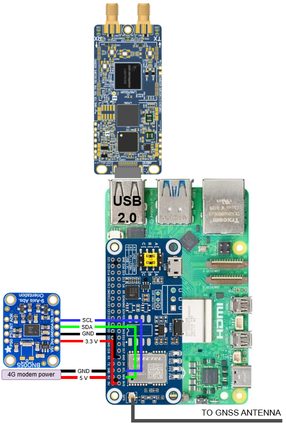

### Hardware connections

The diagram below shows the platform wiring, including the LC29H
GNSS HAT, BNO055 IMU, LimeSDR Mini, and modem power connections.



The LC29H HAT mounts directly onto the Raspberry Pi's 40-pin header
and communicates through UART. The BNO055 uses the I²C interface,
while the LimeSDR Mini connects through USB 2.0.

The instructions below cover configuration and execution of the
GNSS subsystem.

## GNSS Subsystem — Configuration and Execution

This guide covers the GNSS subsystem of the UAV–SDR measurement platform, including LC29H receiver configuration, reception of IBGE NTRIP corrections, and logging of positioning data and rover RTCM observations. RF acquisition and IMU logging are handled separately.

First, enable the Raspberry Pi UART interface, disable the serial login console, and ensure your user has permission to access the serial device. The GNSS scripts use `/dev/ttyAMA0` at 115200 baud by default.

### 1. Install the Python dependency

```bash
python3 -m pip install pyserial
```

### 2. Configure the receiver as a rover

This command applies the rover settings, enables positioning messages and RTCM observation output, saves the configuration, and requests a cold restart.

```bash
python3 lc29h_apply_config.py --profile rover --save --cold
```

Check the generated configuration log to confirm that the receiver accepted the commands.

### 3. Configure NMEA output resolution

Set latitude and longitude to eight decimal places in NMEA minutes and altitude to three decimal places.

```bash
python3 lc29h_apply_config.py --profile precision --pos-dp 8 --alt-dp 3 --save
```

These settings control output resolution, not positioning accuracy.

### 4. Enter your IBGE credentials

Edit these variables near the top of your local copy of `ntrip_rover_ibge.py`:

```python
IBGE_USERNAME = "YOUR_IBGE_USERNAME"
IBGE_PASSWORD = "YOUR_IBGE_PASSWORD"
```

Replace both placeholders with your credentials.

### 5. Start GNSS acquisition

```bash
python3 ntrip_rover_ibge.py --mount RJNI0 --outdir logs --indicator
```

Replace `RJNI0` with the desired IBGE station mountpoint.

The script saves positioning data in CSV format and rover RTCM observations in `.rtcm3` format inside `logs/`. RTCM observation logging requires the receiver to accept the corresponding output configuration.

A successful connection displays `NTRIP connected (200)`. This confirms authentication; RTK solution status is reported separately by `FixQ`: `4` indicates RTK fixed and `5` indicates RTK float.

Press **Ctrl+C** to stop acquisition. Run the configuration scripts and GNSS logger separately, since they access the same UART port.
