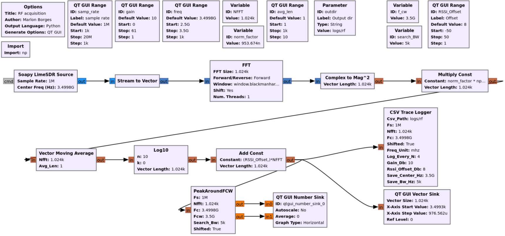

# RF Acquisition Subsystem

GNU Radio flowgraph and Python scripts for narrowband RF acquisition using the LimeSDR Mini.

## Acquisition flowgraph

The flowgraph acquires IQ samples, computes the FFT, averages the spectral power, and applies a calibration offset. The resulting spectrum is displayed, and selected frequency bins around the carrier are saved to CSV.



## 1. Install the required software

Before running the flowgraph, install:

- **GNU Radio Companion**, including GNU Radio's Soapy blocks.
- **LimeSuite**, providing LimeSDR hardware support.
- **SoapySDR** and its **SoapyLMS7** driver for LimeSDR devices.
- **NumPy** and **PyQt5**, required by the Python implementation and graphical interface.

The supplied flowgraph was generated using GNU Radio **3.10.12.0**.

Follow the installation instructions appropriate for your Raspberry Pi operating system:

- [LimeSuite installation and documentation](https://github.com/myriadrf/LimeSuite)
- [SoapySDR documentation](https://github.com/pothosware/SoapySDR/wiki)

Ensure that the LimeSuite USB permission rules are installed so the SDR can be accessed by your regular user.

## 2. Check that the SDR is recognized

Connect the LimeSDR Mini to the Raspberry Pi using a suitable USB data connection.

Check detection through LimeSuite:

```bash
LimeUtil --find
```

Then check detection through SoapySDR, which is the interface used by this flowgraph:

```bash
SoapySDRUtil --find="driver=lime"
```

Inspect the detected device:

```bash
SoapySDRUtil --probe="driver=lime"
```

The output should identify the connected LimeSDR and report its available settings.

If no device is found, check the USB connection, power supply, USB permissions, and installation of the SoapyLMS7 driver before continuing.

## 3. Open the flowgraph in GNU Radio Companion

Start GNU Radio Companion:

```bash
gnuradio-companion
```

Select **File → Open** and open:

```text
rf/RF_narrowband_acquisition.grc
```

Alternatively, from the repository's main directory:

```bash
gnuradio-companion rf/RF_narrowband_acquisition.grc
```

## 4. Review the acquisition settings

Before execution, check the following parameters:

| Parameter | Default value | Description |
|---|---|---|
| `f_cw` | 3.5 GHz | Expected carrier frequency |
| `freq` | 3.4998 GHz | SDR tuning frequency |
| `samp_rate` | 1 MS/s | IQ sampling rate |
| `NFFT` | 1024 | FFT size |
| `gain` | 10 dB | Receiver gain |
| `avg_len` | 1 | Number of FFT frames averaged; 1 disables averaging |
| `RSSI_Offset` | +8 dB | Calibration correction applied to spectral values |
| `search_BW` | 5 kHz | Peak-search half-width around the carrier |
| `outdir` | `logs/rf` | CSV output directory |

**The +8 dB offset is specific to the original measurement setup. Calibrate your own receiver before interpreting the spectral values as absolute received power.**

Configure the parameters before starting acquisition. Restart the flowgraph after changes to the FFT size, averaging length, or logging frequency configuration.

## 5. Run acquisition

Click the **Execute** button in GNU Radio Companion.

A graphical window displays the spectrum and the detected peak level and frequency near the expected carrier.

The GNU Radio Companion console reports the output file:

```text
[EPY] Logging to: logs/rf/trace_YYYYMMDD_HHMMSS.csv
```

Use **Stop** in GNU Radio Companion or close the acquisition window to end recording.

## 6. Locate and interpret the CSV output

The logger automatically creates the output directory. A relative path such as `logs/rf` is resolved from the program's working directory, which may depend on how GNU Radio Companion was launched.

To choose an unambiguous destination, set `outdir` to an absolute path on your own Raspberry Pi before running.

Each CSV contains:

- Acquisition settings in comment lines beginning with `#`.
- A header containing `timestamp` and the saved bin frequencies in MHz.
- Timestamped spectral values after applying the calibration offset.

The current logger saves every fourth FFT frame and retains bins within **±5 kHz** of the expected carrier, corresponding to a requested total span of **10 kHz**.

Timestamps are generated from the Raspberry Pi's local system clock when the logger processes each spectrum; they are not hardware timestamps from the SDR.
